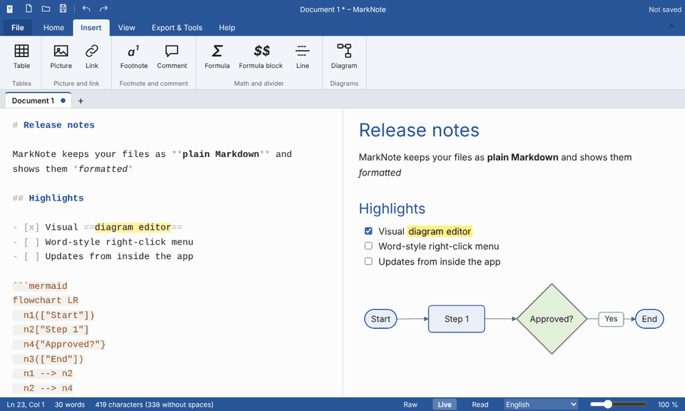
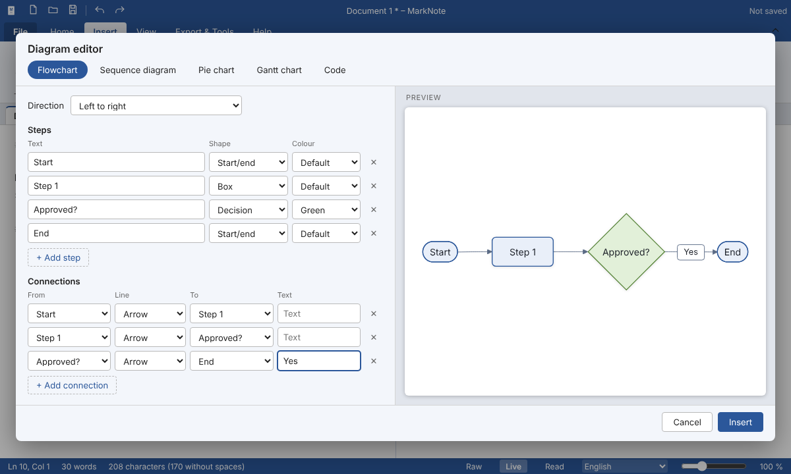
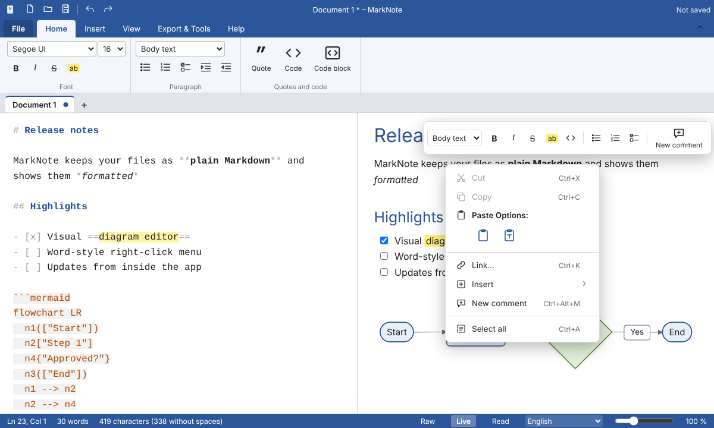

# MarkNote

A Word-style Markdown reader and editor for Windows 10 and 11.

MarkNote gives you the familiar ribbon, title bar, right-click menu and status bar of a word processor, while your documents stay plain `.md` files. Build diagrams without writing code, open Word files, and export to PDF and DOCX. No lock-in, no proprietary format, no account.



**[Download for Windows](https://github.com/Cphmartinus/marknote/releases/latest)** · [Website](https://cphmartinus.github.io/marknote/) · User guide (Word): [English](https://github.com/Cphmartinus/marknote/raw/main/docs/MarkNote-user-guide.docx) · [Danish](https://github.com/Cphmartinus/marknote/raw/main/docs/MarkNote-vejledning.docx)

## Features

- **Three views:** raw Markdown with syntax highlighting, live preview (Markdown and formatted document side by side), and reading mode.
- **WYSIWYG editing:** edit directly in the formatted document in live preview and reading mode. Both panes stay in sync.
- **Word-style interface:** one blue title bar with quick-access buttons, a ribbon with Home, Insert, View, Export & Tools and Help tabs, and a right-click menu with a formatting bar and paste options. Hover over a button to see its shortcut and the Markdown it produces. `Ctrl+F1` hides the ribbon.
- **Diagrams without code:** a visual diagram editor for flowcharts, sequence diagrams, pie charts and Gantt charts. Fill in simple tables and see the diagram drawn instantly in an Office-style look. Diagrams are stored as Mermaid code in the Markdown file, can be edited as code too, and are included in PDF, DOCX and HTML exports.
- **Insert:** interactive table builder, images with automatic relative paths (drag and drop supported), links, footnotes, invisible comments and LaTeX formulas.
- **Tabs:** several documents at once, with unsaved-changes markers.
- **Open Word and HTML files:** `.docx` and `.html` files are converted to Markdown when opened.
- **Export:** PDF, DOCX (real Word format), standalone HTML and plain `.md`.
- **Version history:** automatic snapshots that can be restored.
- **Updates:** MarkNote checks GitHub for new versions (can be turned off), and the installer edition can download, verify and install them for you.
- **Find and replace** with regular expression support.
- **Themes:** Light, Dark, Sepia and Word Blue.
- **13 languages:** Danish, English, German, French, Spanish, Italian, Dutch, Portuguese, Polish, Swedish, Norwegian (Bokmål), Finnish and Icelandic. MarkNote follows your Windows language by default and you can change it in the status bar or on the Help tab.

## A closer look

| Diagram editor | Right-click menu |
| --- | --- |
|  |  |

## Download

Get the latest Windows build from the [Releases page](https://github.com/Cphmartinus/marknote/releases/latest):

- `MarkNote-Setup-<version>.exe` (**recommended**): installs MarkNote, starts fastest, opens `.md` files with a double-click, and can install future updates from *Help → Check for updates*. Install it over an earlier version; your settings are kept.
- `MarkNote-<version>-portable.exe`: runs without installation. It unpacks itself on every start, so it starts more slowly.
- `MarkNote-user-guide.docx` and `MarkNote-vejledning.docx`: user guides in English and Danish.

Releases are built from this repository by GitHub Actions, see [`.github/workflows/build.yml`](.github/workflows/build.yml). What changed in each version is listed in the [changelog](CHANGELOG.md).

### Code signing

The executables are **not code-signed yet**, so Windows SmartScreen may show a warning the first time you run one. Choose **More info → Run anyway**.

We plan to apply for free code signing for open source projects from [SignPath Foundation](https://signpath.org) (provided via [SignPath.io](https://signpath.io)). If approved, releases will be signed and this section will say so. See the [code signing policy](CODE_SIGNING_POLICY.md) and the [privacy policy](PRIVACY.md).

## Build from source

Requires [Node.js](https://nodejs.org/) 22 or newer.

```bash
npm install
npm start                 # run in development
npm run dist              # portable exe in dist/
npm run dist:installer    # installer exe in dist/
```

The Windows build also runs automatically in GitHub Actions (see `.github/workflows/build.yml`).

## Project structure

| Path | Purpose |
| --- | --- |
| `main.js`, `preload.js` | Electron main process: windows, splash screen, file dialogs, export, update check |
| `renderer/` | User interface (HTML, CSS, JavaScript) |
| `renderer/app.js` | Editor, ribbon, tabs, preview, right-click menu, diagrams |
| `renderer/diagram-editor.js` | The visual diagram editor (reads and writes a subset of Mermaid) |
| `renderer/strings.js` | Translations. The Danish text is the key for each row |
| `lib/md.js` | Markdown engine shared by the preview and the DOCX export |
| `lib/docx-export.js` | Markdown to DOCX conversion |
| `afterPack.js` | Sets the icon and file properties on the Windows exe |

## Translations

All user interface text lives in `renderer/strings.js` as rows of `[Danish, English, German, French, Spanish, Italian, Dutch, Portuguese, Polish, Swedish, Norwegian, Finnish, Icelandic]`. Corrections from native speakers are very welcome, especially for Finnish, Icelandic and Polish.

## Support

Questions and bug reports: please open an [issue](https://github.com/Cphmartinus/marknote/issues).

## Code signing and privacy

- [Code signing policy](CODE_SIGNING_POLICY.md)
- [Privacy policy](PRIVACY.md): MarkNote has no telemetry and never sends your documents anywhere. It only asks GitHub, at most once a day, whether a new version exists, and that can be turned off.

## License

[MIT](LICENSE)
